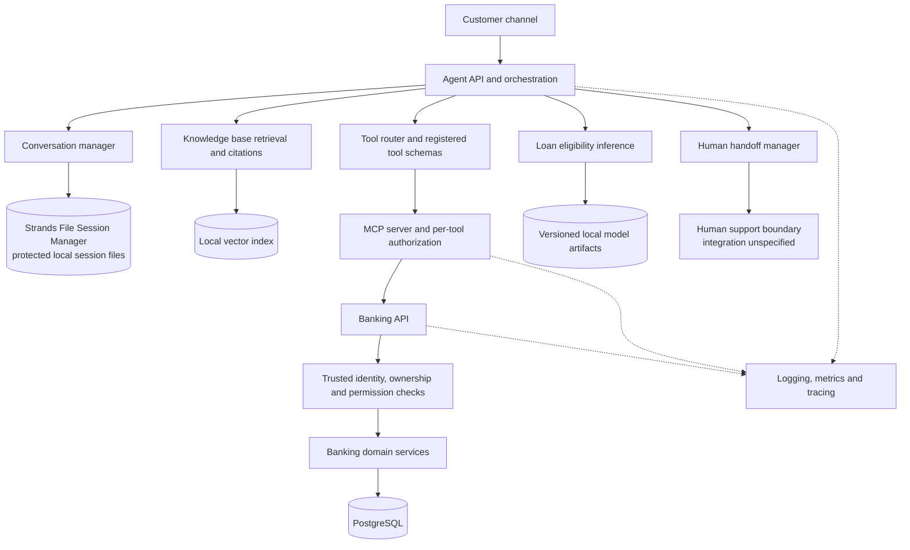

# Architecture Sketch — Rubies MFB Customer Support Agent

**Status:** Accepted  
**Version:** 0.1  
**Scope:** Logical architecture overview; implementation and deployment choices remain subject to the relevant architecture decisions.

## 1. Purpose

This document gives a concise, end-to-end sketch of the Rubies MFB Customer Support Agent. It connects the customer-facing agent, banking operations, retrieval-augmented generation (RAG), loan eligibility inference, session persistence, confirmation controls, and operational oversight.

The system uses synthetic customers, accounts, transactions, cards, loans, and fictional bank policy documents for the capstone.

## 2. High-level architecture

The diagram is a logical sketch, not a deployment topology. It does not imply a decision about Docker, cloud hosting, or the physical placement of processes.

## 3. Main components and responsibilities

| Component | Responsibility | Authority boundary |
|---|---|---|
| Agent API and orchestration | Manage turns, choose between retrieval, read-only tools, sensitive actions, and handoff; compose the final response | The model may propose actions but does not grant itself permission or execute banking writes directly |
| Conversation manager | Maintain conversation context through the Strands File Session Manager adapter | Session state is not the source of truth for identity, permissions, or banking records |
| Knowledge base | Ingest approved policy documents, chunk and index content, retrieve evidence, and assemble document/section citations | Policy answers must be grounded in retrieved evidence; inadequate evidence requires abstention or clarification |
| Tool router and registry | Expose the approved nine-tool catalogue and route validated calls | Tool schemas describe the interface; backend enforcement remains mandatory |
| MCP server | Provide MCP tool access with per-tool authorization | It calls the Banking API and does not access banking tables directly |
| Banking API | Enforce trusted identity, customer ownership, permissions, domain rules, confirmation state, and banking operations | Authoritative application boundary for banking actions |
| PostgreSQL | Persist synthetic banking records, pending confirmations, and audit history | Source of truth for banking data and confirmation lifecycle |
| Loan-model component | Evaluate eligibility using documented features and a versioned model; return supported explanation data | A model result is not a promise of loan approval or disbursement |
| Human handoff manager | Prepare a privacy-conscious case summary and route it to support | Handoff is only reported as accepted when the support system confirms receipt |
| Observability package | Record tool names, inputs, results, authorization decisions, confirmation events, errors, metrics, and traces | Logs must be designed to avoid unnecessary exposure of sensitive information |

## 4. Request paths

### 4.1 Policy or product question

1. Receive the customer message and preserve its meaning, including Nigerian Pidgin.
2. Retrieve relevant passages from the approved knowledge base.
3. Assess whether the evidence is sufficient, current, and consistent.
4. Answer with document and section citations.
5. If evidence is inadequate or conflicting, do not invent a policy answer; ask for clarification or offer handoff.
6. Record retrieval and response metadata for evaluation and observability.

### 4.2 Read-only banking request

1. Resolve customer identity from trusted authenticated session context.
2. Check required verification, customer ownership, and permissions.
3. Execute the relevant read-only tool through the Banking API.
4. Return only customer-scoped results.
5. Record the tool call and outcome.

### 4.3 Sensitive action

1. Validate the requested action and its exact parameters.
2. Create a persistent pending confirmation with expiry and audit history.
3. Present the exact action details to the customer and obtain approval.
4. Validate that approval matches the pending action, is unexpired, belongs to the correct customer, and has not already been used.
5. Enforce the check and execute the action at the Banking API boundary.
6. Record the outcome. If the result is unknown, do not claim success or failure until it is resolved.

### 4.4 Loan question

- For eligibility, call the eligibility tool and return a result with an explanation supported by the model output and approved lending rules.
- For an existing loan, use the loan-status tool.
- If a result cannot be explained adequately, do not invent a reason; offer human review.

### 4.5 Human handoff

Handoff may be triggered by a customer request, unsafe uncertainty, or a frustrated customer who needs human assistance. The agent prepares a concise summary with only relevant context. It reports successful handoff only after confirmation from the support system.

## 5. Trust boundaries and invariants

- **Trusted identity:** Customer identity and customer ID are derived from trusted session/authentication context, never from model-generated tool arguments.
- **Backend authorization:** The Banking API enforces customer ownership and permissions independently of the model and agent prompts.
- **Confirmation:** The backend validates expiry, action details, customer binding, and single-use approval before sensitive execution.
- **No direct database access from the model or MCP server:** Banking operations go through the Banking API.
- **Grounded policy answers:** RAG responses cite their sources; the agent abstains when the evidence is insufficient.
- **Safe uncertainty:** Timeouts or ambiguous outcomes are not treated as proof that an action failed or succeeded.
- **Auditability:** Tool calls record the tool name, inputs, result, and outcome, with sensitive values redacted where appropriate.
- **Synthetic-only data:** The capstone uses synthetic customer and banking data.
- **Session separation:** Conversation files preserve session context but do not replace PostgreSQL or the trusted authentication mechanism.

## 6. Scope boundaries and deferred decisions

The following are intentionally not decided by this sketch:

- Exact hosting, process placement, container topology, and network layout.
- The concrete human-support queue or ticketing integration.
- Final model family, training procedure, and feature set for loan eligibility.
- Final embedding model, chunking parameters, and vector-index implementation details.
- Production identity-provider integration and deployment-grade secret management.

These decisions should be resolved in their respective architecture documents or ADRs rather than silently inferred from this overview.

## 7. Related artifacts

- `docs/architecture/diagrams/system-context.mmd`
- `docs/architecture/diagrams/component-diagram.mmd`
- `docs/architecture/diagrams/deployment-diagram.mmd`
- `docs/architecture/diagrams/data-flow-diagram.mmd`
- `docs/flows/agent-execution-flow.mmd`
- `docs/flows/customer-verification-flow.mmd`
- `docs/flows/confirmation-and-execution-flow.mmd`
- `docs/flows/rag-retrieval-flow.mmd`
- `docs/flows/loan-eligibility-flow.mmd`
- `docs/flows/human-handoff-flow.mmd`

## 8. Review checklist

- [ ] Component responsibilities and trust boundaries are accurate.
- [ ] Confirmation and authorization remain enforced by the Banking API.
- [ ] Session persistence is clearly distinguished from banking persistence and identity.
- [ ] The architecture preserves all nine required tools and the required handoff behavior.
- [ ] Deferred implementation and deployment decisions are not presented as settled.
