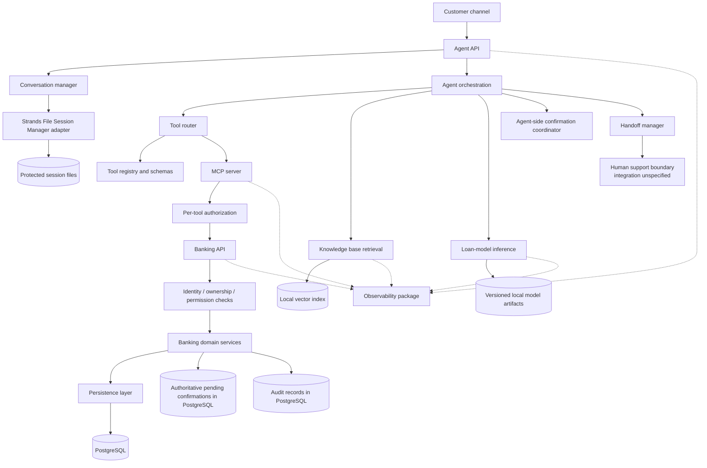

# Component Architecture — Rubies MFB Customer Support Agent

**Status:** Accepted  
**Version:** 0.1  
**Parent document:** `docs/architecture/architecture-sketch.md`

## 1. Purpose

This document defines the responsibilities, interfaces, and trust boundaries of the main logical components. It follows the locked repository schema and the previously agreed architecture decisions. It is a component-level design, not an implementation specification.

## 2. Component map

## 3. Components and contracts

### 3.1 Agent API — `apps/agent/api/`

**Responsibilities**
- Accept customer messages and return agent responses.
- Validate request shape and establish request context.
- Delegate conversation handling and orchestration.
- Return explicit confirmation-required, handoff, and error states where applicable.

**Must not**
- Treat a model-generated customer ID as trusted identity.
- Execute banking writes directly.
- Bypass backend confirmation and authorization checks.

### 3.2 Conversation manager — `apps/agent/conversation/`

**Responsibilities**
- Maintain conversation context and coordinate session loading/saving.
- Use the agreed Strands File Session Manager adapter.
- Keep session lifecycle separate from banking persistence.

**Boundary**
- Session files preserve conversation/session state. They are not the authoritative identity, authorization, banking-record, pending-confirmation, or audit store.

### 3.3 Agent orchestration — `apps/agent/orchestration/`

**Responsibilities**
- Determine whether the request calls for RAG, a read-only tool, a sensitive action, loan functionality, or handoff.
- Coordinate tool routing and response construction.
- Apply prompt-level tool-use policies as defense in depth.
- Ask for clarification or abstain when the request or evidence is insufficient.

**Boundary**
- The model may propose an action; trusted backend services decide whether the action is authorized and may execute.

### 3.4 Tool router and registry — `apps/agent/tools/`

The registry exposes the agreed nine tools:

1. `verify_customer`
2. `get_balance`
3. `get_mini_statement`
4. `get_transaction_status`
5. `open_dispute`
6. `block_card`
7. `check_loan_eligibility`
8. `get_loan_status`
9. `handoff_to_human`

The router validates arguments against the tool schemas and directs calls to their authorized execution path. Confirmation requirements for `open_dispute` and `block_card` are preserved. Any action that moves money, changes records, or sends a message must also follow the agreed confirmation policy.

**Boundary**
- Schema validation is not a substitute for authorization or domain validation.
- Customer identity must be resolved from trusted session context, not model-supplied identifiers.

### 3.5 MCP server — `apps/mcp_server/`

**Responsibilities**
- Expose registered tools through MCP.
- Validate tool inputs and enforce per-tool authorization.
- Call the Banking API for banking operations.

**Boundary**
- The MCP server does not access banking tables directly. Banking authorization and domain rules remain enforced by the Banking API.

### 3.6 Banking API — `apps/banking_api/`

**Responsibilities**
- Resolve or validate trusted identity context.
- Enforce customer ownership, permissions, verification requirements, and domain rules.
- Execute customer-scoped reads and authorized banking actions.
- Maintain pending confirmations and audit history.
- Return explicit outcomes, including rejected, failed, and unknown outcomes where the result cannot yet be established.

**Boundary**
- This is the authoritative application boundary for banking operations. Agent prompts, tool schemas, and MCP permissions do not replace backend enforcement.

### 3.7 PostgreSQL persistence

**Responsibilities**
- Store synthetic customers, accounts, transactions, cards, disputes, and loans.
- Store pending confirmation records with action details, customer binding, expiry, consumed state, and audit history.
- Persist audit records for tool execution and sensitive decisions.

**Boundary**
- Pending confirmations must be validated and consumed safely, with single-use behavior enforced at the backend. A timeout must not be treated as proof that a banking action failed.

### 3.8 Knowledge base — `packages/knowledge_base/`

**Responsibilities**
- Ingest approved policy and product documents.
- Chunk, embed, index, retrieve, and track source versions.
- Return evidence with document and section metadata for citations.

**Boundary**
- If evidence is inadequate, stale, or conflicting, the agent must not invent a policy answer.

### 3.9 Loan-model component — `apps/loan_model/`

**Responsibilities**
- Run eligibility inference using documented features.
- Expose the model version and supported explanation data.
- Support evaluation of model behavior.

**Boundary**
- Do not invent model features or explanations. Eligibility is not a guarantee of loan approval or disbursement. Existing-loan enquiries use `get_loan_status`.

### 3.10 Confirmation manager — `apps/agent/confirmation/`

**Responsibilities**
- Coordinate the customer-facing confirmation interaction.
- Present the exact action and parameters for approval.
- Track the interaction state and call the Banking API to create or validate pending actions.

**Boundary**
- Agent-side confirmation coordination is not authoritative. The Banking API and PostgreSQL own pending-action state, expiry, action matching, single-use approval, and execution enforcement.

### 3.11 Handoff manager — `apps/agent/handoff/`

**Responsibilities**
- Build a concise support summary from relevant conversation context, actions attempted, tool outcomes, citations, and unresolved questions.
- Avoid including unnecessary sensitive information.
- Route the case through the support integration once defined.

**Boundary**
- Do not tell the customer that a human has received the case until the support system confirms acceptance.

### 3.12 Shared security, schemas, and observability packages

- `packages/security/`: identity context, verification, permission helpers, and redaction support.
- `packages/shared/`: shared configuration, schemas, exceptions, and utilities.
- `packages/observability/`: structured logs, metrics, traces, and instrumentation.

These shared packages provide reusable mechanisms; they do not eliminate the need for enforcement at the Banking API boundary.

## 4. Cross-component contracts

| Contract | Caller | Enforcing component | Required behavior |
|---|---|---|---|
| Customer identity | Agent/tool adapter | Trusted identity context + Banking API | Identity comes from trusted authentication/session context |
| Customer ownership | Banking operation | Banking API | Read/write only records belonging to the authenticated customer |
| Tool authorization | Tool router / MCP | MCP authorization and Banking API | Enforce permissions at appropriate boundaries; backend remains authoritative |
| Sensitive action confirmation | Agent confirmation coordinator | Banking API + PostgreSQL | Validate customer, exact action, expiry, unused approval, and execution state |
| RAG citations | Agent response builder | Knowledge base retrieval/citation assembly | Cite approved source document and section |
| Loan explanation | Agent response builder | Loan-model component and approved policy | Report only supported output and explanation |
| Handoff acceptance | Handoff manager | Human-support integration | Claim acceptance only after explicit acknowledgement |
| Tool audit | Agent / MCP / Banking API | Observability and persistent audit | Record tool name, inputs, result, and outcome with sensitive values appropriately redacted |

## 5. Required tool behavior

| Tool | Main purpose | Important control |
|---|---|---|
| `verify_customer` | Establish/verify customer context | Use trusted verification workflow; do not accept a model-invented identity |
| `get_balance` | Retrieve balance | Enforce ownership and required verification |
| `get_mini_statement` | Retrieve recent transactions | Enforce ownership and limit returned data to the customer |
| `get_transaction_status` | Check transaction state | Preserve unknown/pending outcomes; do not infer success from a timeout |
| `open_dispute` | Open a transaction dispute | Confirm the proposed dispute details before creating the record |
| `block_card` | Block a card | Confirm the exact card/action before execution |
| `check_loan_eligibility` | Assess eligibility | Use documented features and supported explanation data |
| `get_loan_status` | Check an existing loan | Enforce ownership and return the persisted status |
| `handoff_to_human` | Escalate a conversation | Log reason and report successful handoff only after acknowledgement |

## 6. Design constraints

- The first version uses synchronous request/response tool execution.
- Banking data is synthetic.
- The local vector index is the initial RAG index.
- Model artifacts are locally versioned.
- Conversation/session persistence uses Strands File Session Manager and protected local files; S3 is not part of this decision.
- Fleet integration remains deferred to its dedicated adapter/entry point.
- The human-support integration is not yet selected.
- Docker/container and cloud deployment choices are outside this logical component design.

## 7. Review checklist

- [ ] All nine tools and their safety controls are represented.
- [ ] The Banking API remains authoritative for customer ownership, permissions, confirmations, and writes.
- [ ] The MCP server does not bypass the Banking API.
- [ ] Session state is distinct from banking and confirmation persistence.
- [ ] RAG citations and abstention behavior are preserved.
- [ ] Loan explanations remain evidence-based.
- [ ] Handoff acceptance is not claimed without acknowledgement.
- [ ] Deferred decisions are not presented as settled.
