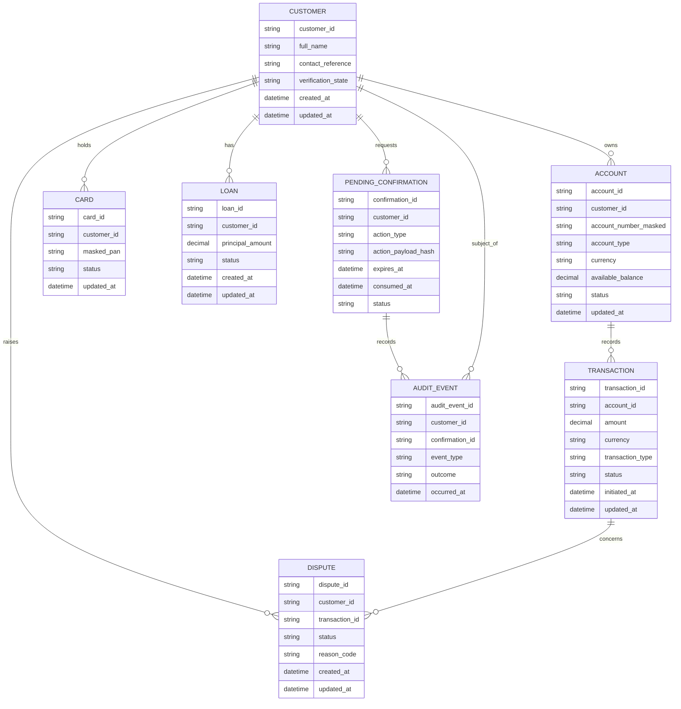

# Data Architecture — Rubies MFB Customer Support Agent

**Status:** Accepted  
**Version:** 0.1  
**Parent document:** `docs/architecture/architecture-sketch.md`

## 1. Purpose

This document defines the logical data domains, ownership boundaries, persistence responsibilities, and key relationships for the Rubies MFB Customer Support Agent capstone. It follows the approved architecture drafts and does not introduce a new deployment or storage decision.

The capstone uses synthetic customer and banking data only.

## 2. Data ownership and storage boundaries

| Data domain | Primary storage | Authoritative owner | Notes |
|---|---|---|---|
| Customer profile and verification state | PostgreSQL | Banking API | Customer identity is resolved from trusted authentication/session context. |
| Accounts and balances | PostgreSQL | Banking API | Account access is scoped to the authenticated customer. |
| Transactions and transaction status | PostgreSQL | Banking API | Includes successful, pending, failed, reversed, and deliberately ambiguous test scenarios where appropriate. |
| Cards | PostgreSQL | Banking API | Card operations require ownership checks; blocking a card requires confirmation. |
| Disputes | PostgreSQL | Banking API | Opening a dispute requires confirmation of the proposed details. |
| Loans and loan status | PostgreSQL | Banking API | Existing-loan status is separate from a new eligibility assessment. |
| Pending confirmations | PostgreSQL | Banking API | Stores action details, customer binding, expiry, consumed state, and lifecycle/audit references. |
| Audit history | PostgreSQL | Banking API and audit service boundary | Persistent record of important tool calls, decisions, confirmation events, and outcomes. |
| Conversation/session state | Protected local session files | Conversation manager via Strands File Session Manager | Not the authority for banking data, identity, authorization, or pending confirmations. |
| Approved policy documents and source metadata | `data/knowledge/` | Knowledge-base ingestion process | Source documents, processed documents, and manifests are kept distinct. |
| Searchable policy vectors | `storage/vector_index/` | Knowledge-base indexing process | Rebuildable index derived from approved source documents and manifests. |
| Loan-model training/validation/test data | `data/model/` | Model training/evaluation pipeline | Synthetic and versioned; splits must be kept separate. |
| Versioned trained model artifacts | `artifacts/loan_model/` | Model release process | Each version should have a manifest describing its version, features, evaluation, and provenance. |
| Evaluation datasets and reports | `evaluation/` | Evaluation process | RAG questions, tool scenarios, safety cases, metrics, regression results, and reports. |

### Source-of-truth rules

1. PostgreSQL is authoritative for banking records, pending confirmations, and persistent audit history.
2. Session files preserve conversation/session context only. They must not be used to determine whether a customer owns an account or whether an action has been approved.
3. The vector index is derived from approved knowledge documents and can be rebuilt; it is not the source of truth for policy content.
4. Model artifacts are immutable, versioned outputs of a training/release process. A model prediction does not replace persisted loan status or approved lending rules.
5. Evaluation reports are evidence about system behavior, not runtime customer records.

## 3. Logical banking data model

The following is a conceptual model. Exact SQL types, indexes, constraints, and migration order will be specified during implementation and must not be inferred from this diagram alone.

**Modeling notes**
- The diagram describes conceptual relationships, not a finalized physical schema.
- Real account numbers and card PANs are not needed for the capstone's agent responses; use masked or synthetic identifiers and never log full sensitive values.
- Transaction status and dispute status are separate lifecycle concepts.
- Loan eligibility assessments should be represented separately from an existing loan's persisted status if assessment history is retained.
- Confirmation records must bind approval to the exact action and parameters, not merely to a generic “yes.”
- Audit events should reference relevant entities where useful without duplicating unnecessary sensitive payloads.

## 4. Pending confirmation data

A pending confirmation record should contain, at minimum:

- A unique confirmation reference.
- Trusted customer/session binding sufficient for backend validation.
- Action type and the exact proposed action parameters, or a secure representation/hash plus a retrievable canonical payload.
- Creation time and expiry time.
- State such as pending, approved/consumed, rejected, expired, or execution outcome unknown.
- Consumption/execution timestamps where applicable.
- Correlation and audit references.
- Idempotency or operation references where needed to resolve retries safely.

### Lifecycle invariants

1. The Banking API creates and owns authoritative pending-action state.
2. Approval must match the customer and the exact action being approved.
3. Expired, mismatched, rejected, or already-consumed approvals cannot execute the action.
4. Consumption and execution must be protected against concurrent duplicate approvals.
5. A timeout after a request is sent does not establish that the operation failed. The system should reconcile using operation/status references instead of blindly repeating a non-idempotent action.
6. The customer-facing confirmation coordinator does not independently authorize or execute sensitive actions.

## 5. Knowledge-base data lifecycle

The approved knowledge content follows this path:

1. **Source documents:** Original fictional banking policy and product documents are kept in `data/knowledge/source_documents/`.
2. **Processing:** Extracted/normalized content is stored in `data/knowledge/processed_documents/`.
3. **Manifest:** `data/knowledge/manifests/` records source identifiers, document versions, processing metadata, and indexing status.
4. **Chunking and embedding:** The ingestion pipeline creates chunks with document and section metadata and computes embeddings.
5. **Indexing:** The local vector index is built from the processed content and embeddings.
6. **Retrieval and citation:** Retrieval returns passages with source document, section, version, and relevant location metadata so the response can cite evidence.
7. **Refresh:** When a source document changes, reprocess and re-index it; preserve enough version information to explain which source supported a previous answer.

The source document and manifest remain the provenance anchor. The vector index is a derived, replaceable artifact.

## 6. Loan-model data lifecycle

The loan-model data is separated into:

- `data/model/training/`
- `data/model/validation/`
- `data/model/test/`

The training process must document the feature definitions, labels, preprocessing, split strategy, and any limitations of the synthetic data. Validation data supports model selection; test data is held back for final evaluation.

Versioned model artifacts live under `artifacts/loan_model/versions/`, with a corresponding manifest under `artifacts/loan_model/manifests/`. The manifest should identify:

- Model version and creation time.
- Training-data and feature-schema version.
- Preprocessing assumptions.
- Evaluation metrics and known limitations.
- Supported inference inputs and output schema.
- Explanation method and the scope of claims it supports.

The inference component should return the model version and explanation data needed for audit and evaluation. It must not invent features or explanations. Eligibility is not a guarantee of approval or disbursement.

## 7. Conversation/session data

The Strands File Session Manager stores conversation/session state in protected local files through the approved adapter.

Controls:
- Apply filesystem permissions and access controls appropriate to the runtime identity.
- Avoid storing secrets or unnecessary full payment/card details in conversation history.
- Redact sensitive values from diagnostic logs.
- Do not treat conversation history as proof of identity, consent, authorization, or completed execution.
- Keep session retention and cleanup policy explicit before deployment.
- Use trusted backend records to resolve pending confirmations and banking operation outcomes.

S3 is not part of the current session-persistence decision.

## 8. Audit and observability data

Tool-call and important decision records should include, where applicable:

- Correlation/request ID and session reference.
- Tool name and validated input summary.
- Authorization/verification decision.
- Result category and outcome.
- Confirmation reference and lifecycle event.
- Model or knowledge-source version where relevant.
- Timestamp and error category.

Do not indiscriminately log full prompts, credentials, complete account numbers, card PANs, or other unnecessary sensitive values. Redaction and access control apply to both application logs and persistent audit records.

Application observability logs, metrics, and traces help diagnose behavior; the persistent audit history remains the durable record for significant banking and confirmation events.

## 9. Synthetic data and privacy boundaries

All customer, account, transaction, card, dispute, and loan records used in the capstone must be synthetic. The dataset should support the required scenarios, including failed transfers, double debit, card issues, and an active loan, without using real customer data.

The synthetic dataset should be internally consistent across customer ownership and foreign-key relationships. Seed scripts should be deterministic where practical so tests and evaluation scenarios can be reproduced.

## 10. Review checklist

- [ ] PostgreSQL is the source of truth for banking records, confirmations, and persistent audit history.
- [ ] Session files are separate from banking and confirmation persistence.
- [ ] The conceptual entities cover all required banking domains.
- [ ] Pending confirmations bind the customer, exact action, expiry, and single-use state.
- [ ] Transaction and dispute lifecycles are distinct.
- [ ] Knowledge documents, processed content, manifests, and vector index have clear provenance.
- [ ] Loan data splits and model artifacts are versioned and documented.
- [ ] Audit data is useful while avoiding unnecessary sensitive values.
- [ ] Only synthetic banking data is used.
- [ ] Physical SQL schema and deployment-specific retention details remain open for implementation decisions.
