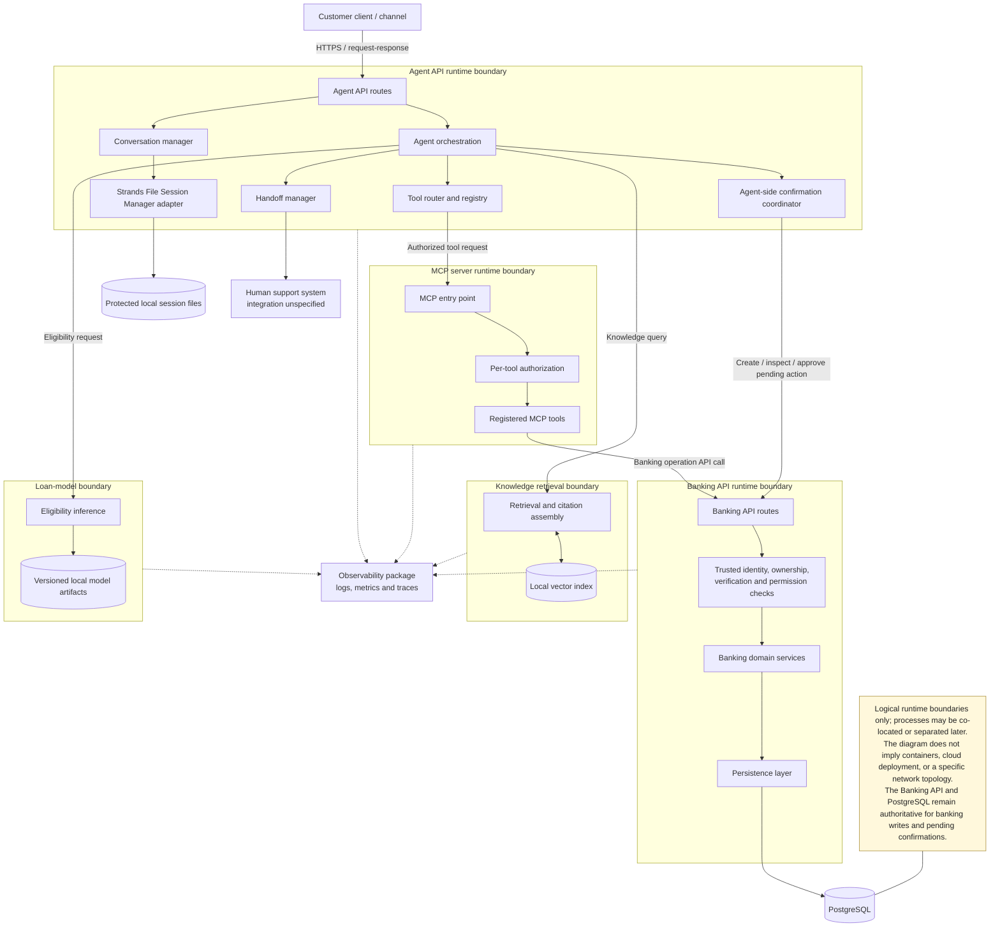

# Deployment Architecture — Rubies MFB Customer Support Agent

**Status:** Accepted  
**Version:** 0.1  
**Parent document:** `docs/architecture/architecture-sketch.md`

## 1. Purpose and scope

This document describes the runtime responsibilities and communication boundaries of the capstone system. It is intentionally deployment-neutral: it does not decide Docker/container topology, cloud hosting, operating-system placement, or production network layout.

The first version uses synchronous request/response tool execution, PostgreSQL for banking persistence, a local vector index for RAG, versioned local model artifacts, and Strands File Session Manager for conversation/session persistence in protected local files.

## 2. Logical runtime view

## 3. Runtime boundaries

### 3.1 Customer-facing agent runtime

The agent runtime receives customer messages, manages conversation turns, coordinates retrieval and tool calls, and produces customer-facing responses. It uses the Strands File Session Manager adapter for conversation/session state.

The session files must be protected by appropriate filesystem permissions and access controls. Session storage is not the authority for customer identity, banking records, permissions, or pending confirmations.

### 3.2 Banking API runtime

The Banking API provides the authoritative interface for banking operations. It checks trusted identity context, customer ownership, required verification, permissions, domain rules, pending-action state, and execution outcomes.

All banking reads and writes pass through this boundary. Other components must not bypass it by directly accessing banking tables.

### 3.3 MCP runtime

The MCP server exposes registered tools and applies per-tool authorization. For banking operations, it calls the Banking API. It does not connect directly to PostgreSQL.

### 3.4 Knowledge retrieval runtime and local index

The retrieval component searches the approved knowledge base and assembles source citations. The initial vector index is local. If retrieval is inadequate, stale, or conflicting, the agent must abstain or ask for clarification rather than invent policy details.

### 3.5 Loan-model runtime and artifacts

The loan-model component performs eligibility inference using documented input features and versioned local model artifacts. The result and explanation must remain supported by model output and approved lending rules.

### 3.6 Persistent data boundaries

- **PostgreSQL:** Synthetic banking records, pending confirmations, and persistent audit history.
- **Protected session files:** Conversation/session state managed through Strands File Session Manager.
- **Local vector index:** Searchable representations of approved policy documents.
- **Versioned local model artifacts:** Loan-model versions and associated metadata.

These stores serve different purposes and must not be treated as interchangeable.

### 3.7 Human-support boundary

The handoff manager prepares a concise, privacy-conscious case summary. The concrete ticketing system, queue, and integration protocol remain undecided. The agent reports a successful handoff only after receiving acknowledgement.

## 4. Communication patterns

| From | To | Purpose | Initial interaction pattern |
|---|---|---|---|
| Customer client | Agent API | Submit message and receive response | Synchronous request/response |
| Agent runtime | Session manager | Load/save conversation state | Local adapter call |
| Agent tool router | MCP server | Invoke registered tool | Synchronous tool request |
| MCP server | Banking API | Execute authorized banking operation | API request/response |
| Agent orchestration | Knowledge retrieval | Retrieve policy evidence | Synchronous retrieval |
| Agent orchestration | Loan model | Assess eligibility | Synchronous inference |
| Banking API | PostgreSQL | Read/write authoritative records | Database transaction |
| Handoff manager | Human support | Submit escalation and receive acknowledgement | Integration unspecified |

## 5. Critical execution and failure rules

- The backend binds operations to trusted customer identity; the model cannot select another customer's records by supplying an identifier.
- The Banking API validates sensitive-action confirmations, including customer binding, exact action details, expiry, and single-use state.
- Confirmation consumption and sensitive execution must be protected against duplicate approval and concurrent requests.
- A timeout or ambiguous response does not prove that an operation failed. The system must resolve or clearly communicate an unknown outcome without blindly repeating a non-idempotent action.
- Every tool call is logged with tool name, inputs, result, and outcome, applying redaction to sensitive values where appropriate.
- Human handoff is considered accepted only after explicit acknowledgement from the support integration.
- Session state, RAG index contents, and model artifacts do not replace PostgreSQL as the source of truth for banking records and pending confirmations.

## 6. Deployment decisions intentionally deferred

This document does not select:
- Docker or another container runtime.
- Local machine, VM, managed cloud service, or production hosting provider.
- Exact process co-location and network segmentation.
- Production TLS termination, secrets management, or identity-provider implementation.
- The human-support/ticketing provider.
- A remote vector database or object storage service.

Those decisions should be documented later when deployment requirements are clear.

## 7. Review checklist

- [ ] Runtime boundaries reflect the agreed component architecture.
- [ ] The Banking API remains the only application boundary for banking operations.
- [ ] MCP does not access PostgreSQL directly.
- [ ] Session files remain distinct from banking and confirmation persistence.
- [ ] The initial synchronous execution model is accurately represented.
- [ ] Sensitive actions retain expiry, single-use approval, audit, and safe-retry requirements.
- [ ] Deferred deployment choices are not implied as settled.
